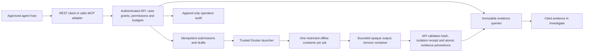

# Agent integration and release status

Updated 2026-10-28. The case-scoped REST service, local stdio MCP adapter, controlled offline submissions, and cited draft workflow are implemented for a **local test candidate**. The distribution advisory gate is cleared for the verified arm64 and amd64 candidates, and agent submissions now run in separate per-job containers. The shared-kernel, trusted-launcher and review limits below still apply. This is not a claim that the software is vulnerability-free.

## Implemented workflow

1. An analyst creates an expiring agent credential in **Settings → Agent access**, selecting explicit cases and permissions. Read operations are the default; submission and draft writes require separate grants.
2. The agent lists analyses, selects a saved run, and reads the immutable manifest before hunting. The manifest identifies the input hash, saved evidence totals, tool/options/rule receipts where available, warnings, and parsing coverage.
3. Typed, signed-cursor queries retrieve the complete saved evidence and flow inventory. Large detector collections are split with JSON Pointer locators and ordered text fragments rather than silently truncated. Historical analyses retain explicit legacy provenance.
4. Findings cite stable analysis/snapshot/evidence IDs. The analyst opens the same record in Investigate, including older runs. Dashboard retains its Top 10 summaries and detailed traffic drill-down.
5. Optional capture submission validates uploaded bytes, enforces persisted quotas and idempotency, and runs with OSINT and LLM calls disabled in a new offline job container. The parser sees only that job’s read-only input and private scratch, with no shared pending captures/results, Docker socket, application database or saved credential mount.
6. Optional draft notes require valid evidence references, remain marked for analyst review, and cannot close a case, change policy, overwrite notes, or publish a verdict.

[Setup, tool contract, REST examples, limits and migration notes](AGENT_USAGE.md).

## Architecture and boundaries

The official MCP Python SDK 2.3.0 handles stdio transport and structured tool results. The adapter discovers permissions and exposes only granted tools; the API independently authorizes every invocation. It accepts dedicated `pha_` credentials, not legacy administration credentials. No remote MCP HTTP transport is enabled. [MCP tools](https://modelcontextprotocol.io/specification/2025-11-25/server/tools)

The API supports `cases:read`, `evidence:read`, `jobs:read`, `captures:submit`, `notes:append`, and `reports:read`. Case grants, expiry, revocation, request rates, daily budgets, and submission quotas are persisted. Agents cannot administer keys, change settings, delete cases, choose a provider URL, execute shell commands, read host paths, or request arbitrary SQL.

PCAP strings, detector output, notes, and reports remain untrusted data. A tool response never grants authority. Conclusions must distinguish observations, hypotheses, contradictions, and unknowns. No match in incomplete packet parsing does not establish absence of a threat. [OWASP prompt injection guidance](https://cheatsheetseries.owasp.org/cheatsheets/LLM_Prompt_Injection_Prevention_Cheat_Sheet.html)

## Completed engineering gates

| Area | Implementation and evidence |
| --- | --- |
| Evidence foundation | Analysis selection; full indexed pagination; actor/filter/snapshot-bound cursors; immutable revisions; large detector retrieval; analysis/IOC/snapshot atomic rollback tests; trusted case deletion purges related evidence |
| Agent authorization | Case/permission matrix, expired/revoked denial, persisted quotas, audit records without tokens or payloads, no legacy admin/delete authority |
| Controlled writes | Real native capture acceptance on both architectures, checked input hash, trusted isolation receipt, idempotent submissions/cited drafts, own-job cancellation, deterministic collection recovery, completion only after container removal and evidence persistence |
| Per-job isolation | Real engine controls: private namespaces/scratch, one read-only input subpath, no other captures/results/socket/database/keys, no network, no privilege escalation, fixed resource/wall limits; cancellation and launcher-restart recovery exercised |
| Runtime maintenance | Hash-locked Python runtime/test dependencies; pinned base images; non-root runtime; read-only roots and resource bounds; checksum-pinned Chrome Headless Shell for offline charts; source-built native parsers and XML binding against patched public Wolfi libraries |
| Application security | Local Host/Origin/JSON boundary, request-size limits, bounded embedded-PNG-only PDF resources, provider-key destination checks, spreadsheet formula protection, protected random-key credential migration |
| Offline reports | Bundled Plotly geographic asset; report/chart tests run with network disabled |
| UI and performance | Lazy chart/map/report/agent components; complete evidence exports with snapshot checks; exact `Deep-Dive Visualization` heading; privacy-mode rendering; preserved Top 10 drill-down |
| CI and docs | Canonical Docker tests, frontend tests/audit, full image scan and SBOM retention; all high/critical (including unfixed) and secret gates; English and Traditional Chinese agent guides |

The operator’s local acceptance packet records test totals, image identity/architecture, browser checks, scanner results, backups and saved-state verification. Local launch and rollback details remain in the operator’s private `.codex/LOCAL_TEST.md`; general setup is in the agent guide. Native amd64 and arm64 CI jobs must both pass, followed by the required aggregate `test` check. Their retained artifacts identify the tested commit, actual runner, runtime image, full scan and SBOM. Consult the final pull request checks before publication.

## Remaining release gates and limits

- **Distribution gate cleared for both tested architectures.** The 30 original Debian CVEs were addressed by removing affected components or replacing them with fixed versions in the public Wolfi runtime. The exact runtime scan reports zero known matches and no secrets; actual XML/DNS linkage and bundled TIFF versions also pass checks. Debian Node/Python build stages do not enter runtime. Native source versions and hashes are in `docker/native-components.json`. Rebuild and rescan each release; a clean advisory scan cannot establish absence of every vulnerability. Local amd64 acceptance used emulation; the separate CI matrix checks actual native runner identity on both architectures.
- **Worker trust boundary:** every capture runs in a fresh container with only its own read-only input and private scratch, process, network and IPC namespaces. A separate trusted launcher owns Docker administration through its socket; a read-only socket mount does not reduce that authority. The launcher does not decode packet-controlled JSON. Parsers never receive its socket or global spools. Containers share the host kernel, so kernel/runtime escapes remain outside this boundary; a hostile multi-tenant deployment needs a separate platform threat assessment.
- **Recovery:** durable request/result collection and idempotency survive API interruption. A restarted worker repeats an interrupted native stage; full per-stage checkpoint/resume and externally anchored attempt history are deferred.
- **Evidence limits:** complete saved inventory does not mean every original packet was parsed. Responses are bounded; browser export is limited to 20 MiB per inventory. Append-only storage is protected through the application, not against its operating-system/database owner. Trusted deletion removes case evidence; minimal audit metadata is retained.
- **Remote access:** the browser workbench trusts local users and binds to loopback. Remote MCP authorization/HTTP transport and multi-user UI authentication are outside this local candidate.
- **Security review coverage:** source review, targeted regressions, dependency/image/secret scans and isolated runtime probes were performed. The managed deep scan could not start because its required permission profile was unavailable; that gate remains uncovered.

## Data preservation and rollback

Saved data was backed up before cutover. Disposable build cache and obsolete PCAP test images/containers were removed; no saved volumes were pruned. The older rollback image was preserved in a verified archive outside Docker, and the immediate pre-update image remains available locally. The local test configuration disables automatic saved-data cleanup. Original captures, case databases and home/settings volumes remain available, with a retained previous image and protected pre-migration settings archives.

Saved credentials now use a random key file or an explicitly supplied protected key. Back up the key together with configuration. Missing/wrong keys fail closed. Downgrading an old image requires restoring pre-migration configuration into a separate rollback volume; an old image cannot read new encryption merely by changing the tag. Restore instructions avoid overwriting the live dataset.

## Development and review workflow

Codex owns implementation, review, testing and final integration. Jev and Claude have no worker, reviewer, approval or signoff role. Anthropic remains an available product provider. The main Codex agent performs a separate read-only acceptance pass. No global vendor definitions are edited. Release preparation uses a feature branch and reviewable pull request; creating a release/tag or merging requires the corresponding publication decision.
